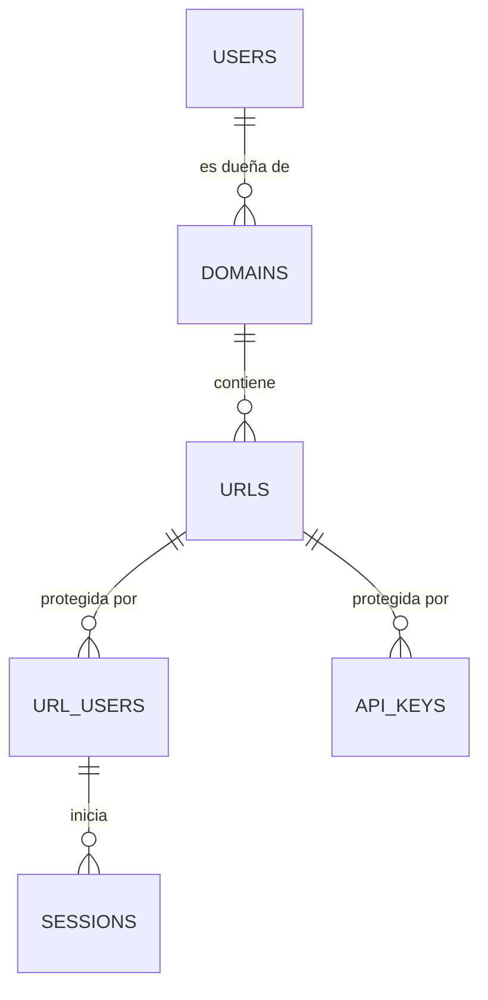

# Modelo de datos — Firestore

Tarea **T-25**. Responsable: Luis Diego Delgado Muñoz.

Este documento define cómo se guarda en **Cloud Firestore** toda la configuración del sistema. Es el
contrato compartido entre los componentes:

- La **UI** escribe sobre este modelo, siempre a través del REST API en Node.js.
- El **REST API en Node.js** es el único componente que lee y escribe directamente en Firestore.
- El **Zonal Cache** y el **DNS Interceptor** leen la configuración mediante los endpoints internos
  del API (ver [contrato-cache-api.md](contrato-cache-api.md)). No acceden a Firestore.

## 1. Decisiones de diseño

| Decisión | Motivo |
| --- | --- |
| Se usa **Firestore** y no Realtime Database | El modelo es jerárquico (dominio → URL → usuarios) y Firestore lo expresa de forma natural con colecciones y subcolecciones, además de permitir consultas por campo. |
| Hay **dos tipos de usuario**, en colecciones distintas | Las personas usuarias de la **plataforma** (`users`) administran dominios desde la UI. Los **usuarios de una URL protegida** (`domains/{d}/urls/{u}/users`) solo existen para autenticarse ante el Zonal Cache. Nunca se mezclan. |
| El ID de un dominio es **su nombre normalizado** | `example.com` en minúscula y sin punto final. Así se garantiza que un dominio no se registre dos veces y la caché lo busca directamente con el encabezado `Host`. |
| Las API keys y sesiones se guardan **por hash** | El ID del documento es el SHA-256 del secreto. El secreto en claro se muestra una sola vez al crearlo y nunca se almacena. La validación es una lectura directa por ID, sin consultas. |
| Las contraseñas de URL protegida usan **bcrypt** | Hash con sal y costo configurable. |
| Los tamaños se expresan en **bytes** y los TTL en **segundos** | Enteros sin unidades ambiguas, fáciles de leer desde GNU C. |
| La política de reemplazo es **por tipo de archivo** | Así lo pide el enunciado: para cada URL se definen los tipos de archivo, su TTL y su política. |
| Fechas como `Timestamp` de Firestore | El API las expone como texto ISO 8601 (UTC) en sus respuestas. |

## 2. Vista general

```text
users/{uid}                                   personas usuarias de la plataforma
domains/{domain}                              dominios registrados
domains/{domain}/urls/{urlId}                 URLs (patrones) dentro del dominio
domains/{domain}/urls/{urlId}/users/{username} usuarios de una URL protegida
apiKeys/{sha256(key)}                         API keys de URLs protegidas
sessions/{sha256(token)}                      sesiones emitidas por usuario y contraseña
```



## 3. Colecciones

### 3.1 `users/{uid}` — personas usuarias de la plataforma

El `uid` es el que asigna **Firebase Authentication**. La contraseña no se guarda aquí: la administra
Firebase Authentication.

| Campo | Tipo | Descripción |
| --- | --- | --- |
| `email` | string | Correo de la cuenta |
| `displayName` | string | Nombre para mostrar |
| `createdAt` | timestamp | Fecha de registro |
| `updatedAt` | timestamp | Última modificación |

### 3.2 `domains/{domain}` — dominios registrados

| Campo | Tipo | Descripción |
| --- | --- | --- |
| `name` | string | Nombre del dominio, igual al ID del documento. Ej. `example.com` |
| `ownerUid` | string | `uid` de la persona dueña (`users/{uid}`) |
| `origin.scheme` | string | `http` o `https` |
| `origin.host` | string | Host o IP del servidor de origen. Ej. `rest-api.default.svc.cluster.local` |
| `origin.port` | number | Puerto del origen. Ej. `80`, `443`, `8080` |
| `cacheSizeBytes` | number | Tamaño máximo de caché en disco para todo el dominio. La suma de los tamaños de sus URLs no puede superarlo |
| `verification.status` | string | `pending` o `verified` |
| `verification.token` | string | Valor aleatorio que debe publicarse en el registro TXT |
| `verification.verifiedAt` | timestamp \| null | Momento en que se verificó la propiedad |
| `createdAt` / `updatedAt` | timestamp | Auditoría |

**Verificación por registro TXT.** Al registrar el dominio, el API genera `verification.token` y
responde con el registro que la persona debe publicar:

```text
Nombre: _proxycache-verify.example.com
Tipo:   TXT
Valor:  proxycache-verification=<token>
```

Cuando la persona solicita la verificación, el API consulta ese registro TXT. Si el valor coincide,
cambia `status` a `verified`. **Solo los dominios verificados** se exponen al Zonal Cache y al DNS
Interceptor.

**Origen.** Como el DNS Interceptor redirige el dominio hacia la caché zonal, la caché no puede
resolver el dominio para llegar al origen real. Por eso el origen se guarda explícitamente.

### 3.3 `domains/{domain}/urls/{urlId}` — URLs del dominio

El `urlId` es un ID generado automáticamente por Firestore.

| Campo | Tipo | Descripción |
| --- | --- | --- |
| `pattern` | string | Patrón de ruta, empieza con `/`. Admite el comodín `*` (ver abajo) |
| `cacheSizeBytes` | number | Porción del tamaño de caché del dominio asignada a esta URL |
| `auth.type` | string | `none`, `api_key` o `user_password` |
| `fileTypes` | map | Configuración por tipo de archivo (ver abajo) |
| `createdAt` / `updatedAt` | timestamp | Auditoría |

**Wildcards.** El comodín `*` coincide con cualquier secuencia de caracteres, incluida la vacía y
`/`. Ejemplos:

| Patrón | Coincide con | No coincide con |
| --- | --- | --- |
| `/` | `/` | `/index.html` |
| `/images/*` | `/images/logo.png`, `/images/a/b.jpg` | `/img/logo.png` |
| `/*.css` | `/style.css`, `/assets/main.css` | `/style.css.map` |
| `/*` | cualquier ruta | — |

Si una ruta coincide con varios patrones, gana el **más específico**: el que tiene más caracteres
literales (sin contar `*`). El API entrega las URLs ya ordenadas de más a menos específica, de modo
que la caché puede quedarse con la primera coincidencia.

**`fileTypes`.** Es un mapa cuya llave es la extensión del archivo en minúscula y sin punto. La llave
especial `*` es el valor por defecto para extensiones no listadas. Si no existe `*`, los archivos de
extensiones no listadas **no se cachean** (se sirven directo del origen).

```json
{
  "html": { "ttlSeconds": 60,    "policy": "LRU" },
  "css":  { "ttlSeconds": 3600,  "policy": "LFU" },
  "js":   { "ttlSeconds": 3600,  "policy": "LFU" },
  "png":  { "ttlSeconds": 86400, "policy": "FIFO" },
  "*":    { "ttlSeconds": 300,   "policy": "RANDOM" }
}
```

Valores permitidos de `policy`: `LRU`, `LFU`, `FIFO`, `MRU`, `RANDOM`.

### 3.4 `domains/{domain}/urls/{urlId}/users/{username}` — usuarios de una URL protegida

Solo aplica cuando `auth.type` es `user_password`. Son **independientes** de las personas usuarias de
la plataforma. El ID del documento es el nombre de usuario.

| Campo | Tipo | Descripción |
| --- | --- | --- |
| `username` | string | Igual al ID del documento |
| `passwordHash` | string | Hash bcrypt de la contraseña |
| `createdAt` / `updatedAt` | timestamp | Auditoría |

### 3.5 `apiKeys/{keyHash}` — API keys

Solo aplica cuando `auth.type` es `api_key`. El ID es el SHA-256 en hexadecimal de la key. La key en
claro tiene la forma `pk_<64 caracteres hex>` y se muestra **una sola vez** al crearla.

| Campo | Tipo | Descripción |
| --- | --- | --- |
| `domain` | string | Dominio al que pertenece |
| `urlId` | string | URL que protege |
| `name` | string | Nombre descriptivo puesto por la persona dueña |
| `prefix` | string | Primeros 10 caracteres de la key, para identificarla en la UI |
| `createdAt` | timestamp | Fecha de creación |

Se guardan en una colección raíz, y no como subcolección de la URL, para que validar una key sea una
sola lectura por ID.

### 3.6 `sessions/{tokenHash}` — sesiones de URLs protegidas

Se crean cuando un usuario de URL protegida se autentica en el formulario de la UI. El ID es el
SHA-256 del token de sesión.

| Campo | Tipo | Descripción |
| --- | --- | --- |
| `domain` | string | Dominio de la sesión |
| `urlId` | string | URL para la que se autenticó |
| `username` | string | Usuario autenticado |
| `createdAt` | timestamp | Inicio de la sesión |
| `expiresAt` | timestamp | Vencimiento. Duración configurable por variable de entorno |

Cerrar sesión elimina el documento. Una sesión vencida se considera inválida aunque el documento
todavía exista.

## 4. Ejemplo completo

```text
users/Xk29...                         { email: "luis@example.com", displayName: "Luis" }

domains/example.com                   { name: "example.com", ownerUid: "Xk29...",
                                        origin: { scheme: "http", host: "apache.default.svc", port: 80 },
                                        cacheSizeBytes: 104857600,
                                        verification: { status: "verified", token: "a1b2...", verifiedAt: ... } }

domains/example.com/urls/u1           { pattern: "/*", cacheSizeBytes: 52428800,
                                        auth: { type: "none" },
                                        fileTypes: { html: { ttlSeconds: 60, policy: "LRU" } } }

domains/example.com/urls/u2           { pattern: "/admin/*", cacheSizeBytes: 10485760,
                                        auth: { type: "user_password" },
                                        fileTypes: { "*": { ttlSeconds: 30, policy: "MRU" } } }

domains/example.com/urls/u2/users/ana { username: "ana", passwordHash: "$2b$10$..." }

apiKeys/9f86d0...                     { domain: "example.com", urlId: "u3", name: "postman", prefix: "pk_3fa91c2" }

sessions/2c26b4...                    { domain: "example.com", urlId: "u2", username: "ana", expiresAt: ... }
```

## 5. Reglas de seguridad de Firestore

Como solo el REST API accede a Firestore, y lo hace con el **Admin SDK** (que ignora las reglas), las
reglas niegan todo acceso directo desde clientes:

```text
rules_version = '2';
service cloud.firestore {
  match /databases/{database}/documents {
    match /{document=**} {
      allow read, write: if false;
    }
  }
}
```

La autorización (quién puede modificar qué dominio) se aplica dentro del API. Ver
[seguridad-api.md](seguridad-api.md) (T-32).
